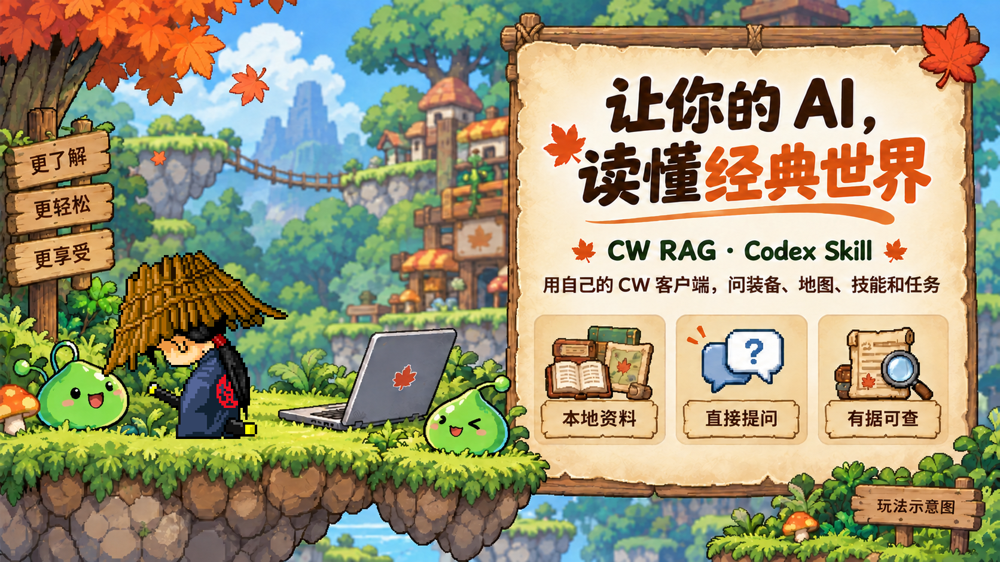
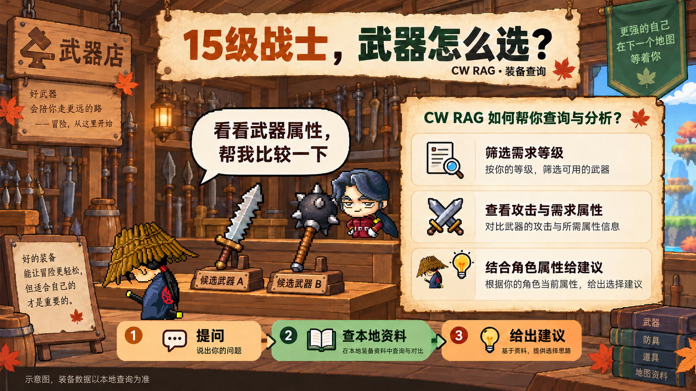
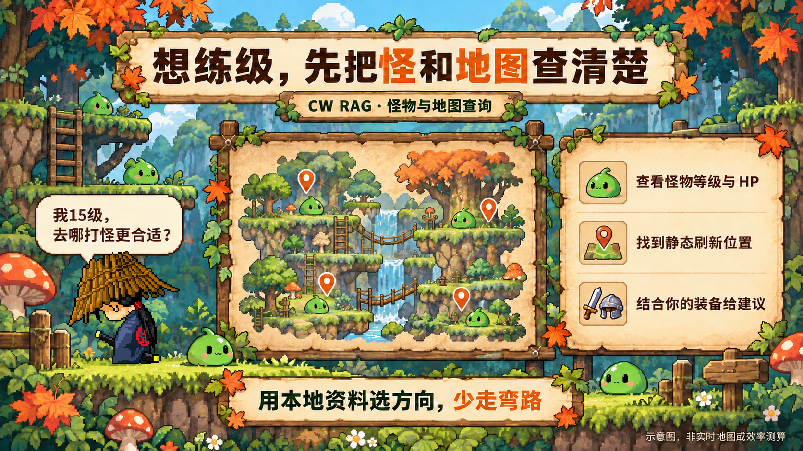
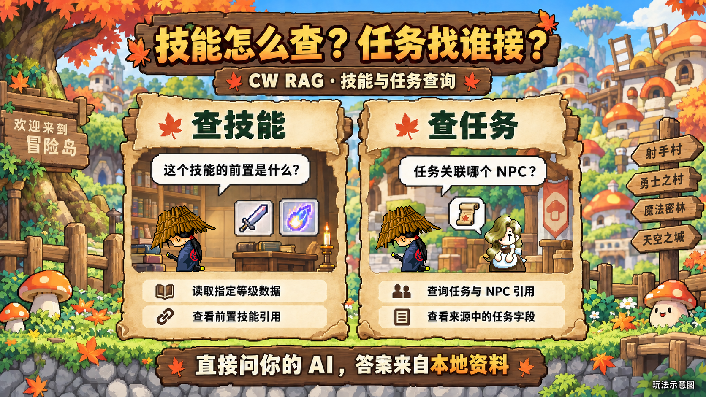

# MapleStory Classic World 本地 RAG：CW RAG Codex Skill

简体中文 | [English](README.en.md)　·　版本 1.0.0　·　[更新记录](CHANGELOG.md)



[GitHub 仓库](https://github.com/PigeonAI-Yang/cw-rag)

CW RAG（Classic World RAG）是一个供 Codex 使用的本地 Skill，用来检索 MapleStory Classic World（冒险岛经典世界）客户端静态数据。它在用户指定目录创建 SQLite 快照。Python 和 SQLite 负责索引与查询，SQLite FTS5 检索文本，SQLite 查询读取结构字段和静态关系。CW RAG 不包含托管助手或模型 API，不使用 embeddings 或向量数据库。客户端文件只读，查询只读取已保存的快照。

## 它怎么帮你玩 CW

配图是玩法示意，具体答案以你的本地查询结果为准。回答先给出实用建议，再用本地记录能确认的等级、力量或基础攻击等熟悉属性说明理由；只提会影响选择的未知或缺失信息。

### 比较装备



> 我15级战士，帮我比较武器的攻击和需求属性。

从装备原始字段里筛选候选，再结合你提供的角色属性比较。

### 找怪物和练级地图



> 我15级，哪些怪和地图值得考虑？

先查怪物等级、HP和地图静态位置，再结合装备给出建议。

### 查技能和任务



> 这个技能的前置是什么？这个任务关联哪个 NPC？

读取指定技能等级、前置引用和任务字段，回答能查到的条件。

## 数据范围

| 类型 | 可检索的数据 |
| --- | --- |
| 怪物 | 等级、HP、来源文本 |
| 地图 | 怪物和 NPC 的静态位置、传送门引用 |
| 装备 | 需求等级、原始属性 |
| 物品 | 来源原始字段和效果字段 |
| 技能 | 指定等级的原始数据、前置技能引用 |
| NPC | 静态字段、地图到 NPC 的引用 |
| 任务 | Check、Act 阶段和字面引用 |
| 套装 | 支持解析；已验收客户端来源为空 |
| 配方 | 支持解析；已验收客户端来源为空 |

已验收客户端中的 `SetItemInfo.img` 和 `ItemMake.img` 有效但内容为空，因此该样本没有套装或配方记录。其他客户端的数据以实际构建结果为准。静态引用不代表实时可用性或游戏行为。

## 安装

以下命令使用 Windows PowerShell 和 Python 3.10 或更新版本。可以更换克隆目录，但要同步修改 `$cwSkillSource`：

```powershell
git clone https://github.com/PigeonAI-Yang/cw-rag.git "J:\PigeonYang\Skills\cw-rag"
$cwSkillSource = 'J:\PigeonYang\Skills\cw-rag'

if ($env:CODEX_HOME) {
    $cwSkillLink = Join-Path $env:CODEX_HOME 'skills\cw-rag'
} else {
    $cwSkillLink = Join-Path $env:USERPROFILE '.codex\skills\cw-rag'
}

$cwSkillParent = Split-Path -Parent $cwSkillLink
New-Item -ItemType Directory -Path $cwSkillParent -Force | Out-Null
if (Test-Path -LiteralPath $cwSkillLink) {
    throw '请先检查已有目标路径；只有它已指向当前源目录时才复用。'
}
New-Item -ItemType Junction -Path $cwSkillLink -Target $cwSkillSource
Get-Item -Force -LiteralPath $cwSkillLink | Format-List FullName, LinkType, Target
```

如果目标路径已存在，先用 `Get-Item -Force -LiteralPath $cwSkillLink` 检查。目标正确时复用现有链接，并跳过 `Test-Path` 和创建 Junction 的命令。不要直接覆盖或替换已有目标。完成后，新一轮 Codex 对话可以使用此 Skill。安装不会扫描客户端或创建索引；首次导入或刷新必须由用户明确提出，并提供客户端和数据目录。

安装解析器依赖：

```powershell
py -3 -m pip install -r "$cwSkillSource\requirements.txt"
```

## 首次构建本地快照

只有用户明确要求首次导入或刷新时才运行 `build`。将示例路径替换为本机客户端目录和单独的数据目录。不要把索引写入客户端目录或 Git 仓库：

```powershell
$cwClientPath = 'J:\path\to\ClassicWorld'
$cwDataDir = 'J:\PigeonYang\data\cw-rag'

py -3 "$cwSkillSource\scripts\cw_rag.py" inspect --client $cwClientPath
py -3 "$cwSkillSource\scripts\cw_rag.py" build --client $cwClientPath --data-dir $cwDataDir
py -3 "$cwSkillSource\scripts\cw_rag.py" status --data-dir $cwDataDir
```

已有快照的查询不会检查客户端，也不会自动刷新。下面是直接查询示例：

```powershell
py -3 "$cwSkillSource\scripts\cw_rag.py" query --data-dir $cwDataDir --kind mob --text "Slime"
```

也可以用自然语言询问 Codex：

- 15级战士能用哪些武器？比较攻击和需求属性
- Where can I find Slime in my local snapshot?
- Show prerequisites and the stored level 3 values for skill 1000000.

这些是提问示例，不代表已有答案。对于已有快照，Codex 先做一条范围有限的查询，只有缺少回答所需字段时才查询指定详情或关系。单次查询不会构建、刷新或测试，也不会启动子代理或调查仓库、网页。`reqJob` 保留为原始数值，不能据此判断某职业能否装备物品。快照也不包含实时掉落率、服务器倍率或战斗公式。

## 常见问题

### CW RAG 是什么？

它是一个在本机检索 MapleStory Classic World 静态客户端数据的 Codex Skill，读取用户选定目录中的 SQLite 快照。

### 查询会上传客户端文件或连接服务器吗？

CW RAG 命令行只查询本地 SQLite 快照，不会发起网络请求或上传客户端文件。不过，这不代表使用的 AI 服务也在本地运行；该服务如何处理提示和检索结果由 AI 服务提供方决定。

### 它包含 AI 模型或需要向量检索吗？

不包含。CW RAG 用 Python 和 SQLite 检索本地快照。FTS5 用于文本检索，SQLite 查询用于读取结构字段和静态关系。CLI 不调用模型 API，也不依赖 embeddings 或向量数据库。由你使用的 AI 根据检索结果组织答案。

### 可以用中文提问吗？

可以。Skill 会把可能的中文名称或概念改写成英文来源词，或使用你提供的 ID。索引保留客户端英文原文，不添加中文译名或中文回退数据。

### 能算出精确练级效率或伤害吗？

伤害不能从客户端文件推出。快照保存的是静态客户端数据，不提供实时掉落、服务器倍率、战斗公式或任务执行结果，所以**单刀伤害必须由你在游戏内实测**。

练级决策可以做，而且是按时间成本算的：子 Skill [cw-rag-leveling](skills/cw-rag-leveling/README.md) 用**从客户端提取的真实攻击间隔**（攻速 4 ≈ 720 ms，攻速 8 ≈ 900 ms），把「几刀砍死」折算成「几秒砍死」，按**每秒经验**排序。

## 子 Skill

| 子 Skill | 用途 |
| --- | --- |
| [cw-rag-leveling](skills/cw-rag-leveling/README.md) | 按每秒经验排出练级路线，附武器（含真实挥刀时间）、攻速与加点建议 |

子 Skill 复用同一个快照，另外会读取客户端的攻击动作帧延迟来计算挥刀时间。它不访问网络、不写客户端。

子 Skill 使用的数据分为四级，并在文档里逐项标注：**从客户端读出**（怪物属性、帧延迟、武器倍率）、**候选**（帧延迟缩放规则、减伤规则，来自社区指南而非客户端清单）、**实测**（玩家报告的单刀伤害）、**不存在**（掉落率、服务器倍率、活动加成）。

## 运行测试

测试使用 `unittest`，全部基于合成快照，**不需要真实客户端**：

```powershell
cd "$cwSkillSource"
py -3 -m unittest discover -s tests -v
```

只跑练级子 Skill 的测试：

```powershell
py -3 -m unittest tests.test_cw_leveling -v
```

英文版 [README.en.md](README.en.md) 包含完整 CLI 参数、分页限制和验收记录。[SKILL.md](SKILL.md) 说明查询行为；[docs/DESIGN.md](docs/DESIGN.md) 记录实现契约；[docs/SOURCE_PROVENANCE.md](docs/SOURCE_PROVENANCE.md) 记录解析器来源和许可。
